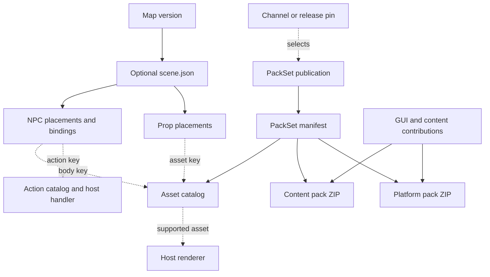

A **map** provides the world, a **scene** describes the objects and interactions placed in that world, and a **PackSet** selects the resource packs delivered to the Minecraft client. These are separate pieces of content with separate publication and activation steps.

For example, a lobby map can have a scene containing a navigator NPC. The scene places that NPC, gives it a label, and binds a click to the lobby navigator action. The asset catalog declares its body asset. The server's renderer creates its appearance and interaction resources. Resource packs provide the client-side resources required by the graphics and UI used in the experience.

## Map and scene

### Map

A map is the world content loaded by a game server: terrain, authored blocks, and supporting files. It has an address, such as `lobby/mainlobby`, and published versions. Its optional root `scene.json` travels with the world bundle.

### Scene

A scene is a **document describing placed content and behavior**. It answers:

- Which props and NPCs exist here?
- Where are they, how are they rotated, and how large are they?
- Which assets do they refer to?
- What happens when a player clicks, looks at, or approaches an NPC?

The scene contains groups, elements, transforms, and typed interaction bindings. It references exact asset and action catalogs. It does not contain texture files, models, or a snapshot of spawned server entities.

The authoring file is `scene.json` at the map root. A map without that file has no scene. The current lobby loads the selected scene when it starts; it does not replace a running scene when a map pin changes.

### Scene element, prop, composite, and NPC

| Term | Meaning | Example |
| --- | --- | --- |
| Element | One placed object in a scene, with a local ID and transform | `navigator` |
| Prop | A placed asset without the NPC interaction-binding model | A marker using `grounds:editor/marker` |
| Composite prop | Several asset parts arranged under one root transform | A decorative assembly whose parts have local transforms |
| NPC | A placed body asset with optional label, look behavior, collision, sensors, and trigger bindings | A guide using `grounds:editor/guide` |
| Group | An organizational collection referenced by elements | A group for objects around the lobby entrance |
| Transform | Position, rotation, and scale | An NPC at the entrance facing the spawn |

An NPC is a scene element with a supported body renderer; the term does not require a player skin or a particular vanilla entity type. The current lobby uses explicit placeholder renderer factories for its guide and marker assets.

## Asset and catalog

### Asset

An asset is a named reusable resource or rendering capability. A scene refers to it by a stable namespaced key, such as `grounds:editor/guide`, rather than a raw file path or an arbitrary download URL.

Several scene elements can reference the same asset while having different positions, labels, and bindings. The asset definition is shared; each element is a separate placement.

Asset files can include textures, models, fonts, sounds, or shaders. A catalog key describes an approved capability; it does not mean the scene host can render every resource found in a ZIP automatically. Some current assets are rendered by host-owned placeholders.

### Asset catalog

The asset catalog is the **typed inventory of assets the system recognizes**. It declares keys, kinds such as `PROP` or `NPC_BODY`, bounds, animation metadata, and compatibility. The scene stores the catalog's exact ID and version so validation is reproducible.

Grounds publishes this information as the JVM artifact `resourcepacks-catalog`. The artifact also exposes shared GUI declarations. It contains declarations and metadata, not the pack ZIP bytes.

A catalog is not a directory scan of whatever files happen to be downloaded. Adding a model file alone does not create a catalog entry or a renderer factory.

### Renderer

A renderer is server-side code that implements the appearance of a supported asset. It translates a scene's transform and viewer state into the platform resources or packets needed to display it. It owns those resources and releases them during scene cleanup.

The responsibilities fit together as **scene placement → catalog definition → renderer capability**. A scene can pass format validation yet fail host preflight when the renderer does not support a required capability.

## Trigger, condition, binding, and action

| Term | Question it answers | Example |
| --- | --- | --- |
| Trigger | What event starts evaluation? | `RIGHT_CLICK` on the navigator NPC |
| Condition | Which player/input is allowed? | Main hand, a permission, or a game mode |
| Binding | What rule connects that event to behavior? | A right-click rule with conditions, timing, and actions |
| Action | What should happen after the rule accepts the event? | Open the navigator or send a message |
| Application action | Which host-owned feature should execute? | `grounds:lobby/open_navigator` |
| Action catalog | Which application actions and arguments are valid? | `grounds:actions` revision `2` |

Built-in actions cover typed scene effects and player feedback. Application actions invoke a registered host handler. Neither is an arbitrary server-command string. The action catalog declares the contract; the host's action registry supplies the executable handler.

Cooldown and debounce belong to the binding. Different players can have separate viewer state, such as hover highlights, even though they interact with the same NPC.

## Pack, contribution, and PackSet

### Pack

A pack is **one Minecraft resource-pack ZIP**. It contains client resources plus pack metadata. A player can receive more than one pack, and their order determines which resource wins when paths overlap.

A pack entry in the PackSet manifest identifies its URL, UUID, hashes, size, format, and order. The UUID identifies the logical pack; the hashes identify its exact bytes.

Grounds currently builds two packs:

| Pack | Responsibility | Stack order |
| --- | --- | --- |
| `grounds-content` | Content resources owned by the product | First, lower priority |
| `grounds-platform` | Shared Grounds platform graphics, including the GUI theme | Second, higher priority |

A resource pack supplies client resources. The server implements NPC interaction, permissions, collision, and application actions. Downloading a pack does not instantiate an NPC or publish a map.

### Contribution

A contribution is **one feature's input to the pack builder**. It declares an owner ID, files, supported formats, and any required resource claims or capabilities. For example, the GUI library produces a contribution from its theme declaration.

Several contributions can be composed into one pack. A contribution is not a separate ZIP the proxy sends to players. The product owns the final pack definition and rejects conflicting paths inside that pack instead of silently picking a contributor.

### PackSet

A PackSet is a **versioned distribution containing an ordered collection of packs and their shared catalog metadata**. The current product is `grounds-global`.

It gives the resolver one coherent contract for:

- The exact packs and their order.
- The catalog belonging to the publication.
- Minecraft and resource-pack-format compatibility.
- Artifact integrity and source provenance.

A PackSet is not a third resource-pack ZIP. Its manifest ties the content ZIP, platform ZIP, and catalog artifact together. Velocity resolves that manifest and sends the ordered pack request to the player.

### GUI theme

A theme is the shared declaration of GUI panels, icons, tooltips, and frames. It supplies identifiers used by server-side GUI code and the resource contribution used by the pack builder. This keeps both sides of the GUI aligned.

`GroundsGuiTheme` and `GroundsGuiIds` expose the approved Grounds theme through the catalog. The theme is part of the platform pack's content; it is neither a scene nor a separate delivery channel.

## Manifest, publication, channel, and pin

| Term | Meaning | Example |
| --- | --- | --- |
| Manifest | Metadata that binds artifacts, identities, compatibility, and hashes | PackSet `manifest.json` |
| Publication | One immutable output of a release or build | Release `v1.1.0` |
| Release | A published semantic version of the PackSet | Product version `1.1.0` |
| Build | An immutable publication identified by its source commit | An Edge build under a full commit SHA |
| Channel | A mutable pointer to the publication to follow | `stable` or `edge` |
| Release pin | An exact release selected instead of following a channel | `source.pin.id = v1.1.0` |
| Environment | The deployment scope that owns a selection | `stage` |
| Config document version | A concurrency token for changing selection | `10` |

The PackSet manifest describes asset distribution. The map pipeline has a different derived manifest describing the world/scene bundle. They are separate documents.

Stable follows release publications; Edge follows build publications. A release pin overrides the configured channel until cleared. An environment does not imply a channel: Stage can follow Edge, Stable, or a compatible release pin.

Map pins select **which world version a server loads**. PackSet pins select **which pack publication Velocity delivers**. Moving either one does not move the other. Config document version, product version, catalog version, and scene schema version are also separate values.

## See the relationships

A builder edits **placements and bindings** in the scene. An asset owner updates **contributions, catalogs, and renderer support**. An operator selects **map and PackSet publications**. A player sees the server's scene using the client resources and UI supplied by the delivered packs.

Continue with [the authoring walkthrough](/build/content/scene-editor), [the scene format](/reference/plugins/scenes/format), or [PackSet architecture](/reference/plugins/resourcepacks/index).

## Implementation sources

Definitions follow the source snapshots used by the surrounding documentation, verified on October 14, 2026.

- [Scene document and elements](https://github.com/groundsgg/library-scene/blob/dbe3fca13c9d552dc885b172193d21bc9c59e8c8/scene-format/src/main/kotlin/gg/grounds/scene/format/SceneDocument.kt)
- [PackSet and contribution ownership](/build/content/packset-build#contribution-api)
- [Catalog and renderer boundary](/reference/plugins/scenes/runtime#renderer-spi)
- [Publication and selection contracts](/reference/plugins/resourcepacks/index)
