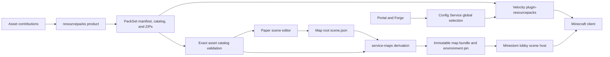

A Grounds NPC belongs to a **scene**, a versioned document stored with a map. The scene describes placement, labels, interactions, and actions. A **PackSet** delivers the client assets those scenes and the Grounds UI refer to. You publish and activate maps and PackSets through separate workflows.

<CardGroup cols={2}>
<Card title="Create an NPC" icon="person" href="/build/content/scene-editor">Create, place, label, and configure an NPC on a Paper build server.</Card>
<Card title="Manage resource packs" icon="box" href="/build/portal/resource-packs">Inspect PackSets and select a channel or release for Stage in the Portal.</Card>
<Card title="Integrate a scene host" icon="code" href="/reference/plugins/scenes/runtime">Implement the Minestom renderer and action contracts.</Card>
<Card title="Build and publish assets" icon="hammer" href="/build/content/packset-build">Compose contributions and publish immutable PackSet artifacts.</Card>
</CardGroup>

## Ownership and data flow

| Concept | Meaning | Version boundary |
| --- | --- | --- |
| Scene | NPCs, props, groups, transforms, and typed actions | Scene schema `1`; asset/action catalogs pinned by ID and version |
| Asset catalog | Declares which asset keys and capabilities exist | `grounds:assets`; delivered as a JVM catalog artifact |
| Action catalog | Declares application actions and their argument contracts | `grounds:actions` revision `1` or `2`; independent of Maven version |
| Map version | Published world bytes and the scene sidecar | Content-addressed derived bundle, selected by map pin |
| PackSet | Ordered pack stack plus catalog and provenance | Manifest schema `2`; immutable release or build identity |
| Selection document | Configured PackSet channel or exact release | Config schema `1`; optimistic document version |

## Follow the right workflow

<Steps>
<Step title="Author and save">Edit the scene in your build world, validate it, and run `/scene save`. A saved sidecar becomes part of the next map source upload.</Step>
<Step title="Derive and publish the map">The map pipeline validates the exact catalog references and emits a canonical scene with the world bundle. Check derive status before moving a map pin.</Step>
<Step title="Make the assets available">Build and publish the PackSet that declares the scene assets. A published PackSet does not change the active Config selection by itself.</Step>
<Step title="Load and deliver">The lobby loads the selected scene at startup. Velocity resolves the configured PackSet in the background and offers it at login or the next backend connection.</Step>
</Steps>

<Note>
Changing a PackSet selection does not replace a running lobby's scene or world. Changing a map pin does not select a PackSet. Keep the asset catalog supported by the editor, derivation worker, and scene host compatible with the map you activate.
</Note>

## Current implementation scope

The lobby uses explicit renderer factories for the `grounds:editor/guide` NPC body and `grounds:editor/marker` prop. It supports authored transforms, labels, private highlights, collision, and the catalog-backed lobby navigator action. The general scene library can describe more capabilities than this host implements; unsupported capabilities fail preflight.

Pack delivery is global through Velocity. Per-gamemode overlays and a Minestom delivery adapter are not implemented. The Portal selection endpoint is fixed to **Stage**, even when the Portal itself is served from its production URL.

Start with [scene authoring](/build/content/scene-editor), [scene format](/reference/plugins/scenes/format), [map publication](/build/content/scene-map-pipeline), or [PackSet architecture](/reference/plugins/resourcepacks/index).

## Implementation sources

Verified against the main-branch source on October 14, 2026.

- [Scene host](https://github.com/groundsgg/minestom-lobby/blob/628da000fc01bf541078e4160b441cbe7e361a25/src/main/kotlin/gg/grounds/minestom/lobby/scene/LobbySceneLoader.kt)
- [Selection semantics](https://github.com/groundsgg/grounds-forge/blob/fdbfd636bf776e3aeea7e70718e8989da3a437a6/src/resourcepacks/selection.ts)
- [Velocity delivery](https://github.com/groundsgg/plugin-resourcepacks/blob/e34725c57730cc9821cd652ddc5121f1f7045c88/README.md)
