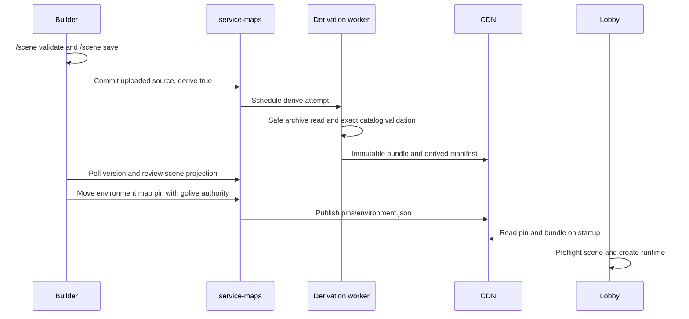

Save your scene before uploading the map source. `scene.json` travels with the map; it is not published through a separate NPC endpoint. The map registry owns versions and environment pins, while the CDN serves world bytes and the sidecar.

## Source to playable bundle

The derivation worker rejects a source containing reserved `grounds/derived-manifest.json`. It identifies only the root `scene.json`, decodes and validates it, substitutes canonical encoded bytes, and writes a derived bundle containing `grounds/derived-manifest.json`. The manifest records source digest, scene presence, scene hash/schema, exact catalogs, and sorted distinct required application actions.

Asset catalogs come from validated Stable/Edge PackSet snapshots and must match the requested catalog reference. Finding a newer catalog is not a reason to reinterpret an older scene.

## Derivation controls and API

| Setting | Behavior |
| --- | --- |
| `MAPS_DERIVE_ENABLED` | Default `false`; enable asynchronous source derivation |
| Commit body `derive: true` | Explicitly request derivation during rollout |
| `MAPS_DERIVE_REQUIRED` | Requires derivation enabled and rejects source commits omitting `derive: true` |

Poll `GET /v1/maps/{address}/versions/{version}` for the attempt/failure fields and scene projection. Scene status is `PENDING`, `INVALID`, `NONE`, or `VALID`; a pending projection is not acceptance.

`POST /v1/maps/{address}/versions/{version}/derive/retry` returns `202` for a retryable **SYSTEM** failure and requires publish authority. Fix scene/content errors before committing new source; retry does not turn invalid content into a valid scene. A failed Job submission remains a reconciliation candidate.

When derivation is enabled, the legacy publish path rejects uploaded-source versions. Source-less compatibility versions and forks have separate behavior. Do not bypass derivation by trying to publish unvalidated source bytes directly.

## Publication versus activation

Publishing makes a version eligible for selection. Moving a map pin changes what subsequent server startups load. Golive permission is required for pin moves even if you own the map namespace. Authoring, publishing, and going live are separate authorities.

A map address can have slashes inside its namespace, such as `u/creator/mainlobby`; split at the **last** slash. The API's map address is a catch-all path, not necessarily two path segments.

## Lobby startup

| Environment variable | Behavior |
| --- | --- |
| `GROUNDS_LOBBY_MAP` | Published map address; unset loads the baked/local world |
| `GROUNDS_LOBBY_MAP_PATH` | Local map path for the baked/local world |
| `MAPS_ENVIRONMENT` | Environment pin file; default `stage` |
| `MAPS_CDN_BASE` | Map distribution origin; default `https://maps.grounds.gg` |
| `MAPS_CACHE_DIR` | Cache unpacked immutable bundles by digest |

The lobby reads CDN pins and bundles, not service-maps. A download/pin failure can use its baked world. After a world is selected, a present malformed, nonregular/symlinked, oversized, or unsupported root sidecar is fatal; the host does not silently ignore it or choose another world.

A published map preserves address and version even when bundle bytes are shared. A local map uses `local:<absolute-normalized-map-root>` and map version `0`. The scene runtime uses that same identity.

## Verify a delivery

<Steps>
<Step title="Review the authored state">Check NPC position, label, action catalog, collision, and a successful save. Ensure no unsaved session edits remain.</Step>
<Step title="Review the derived state">Poll the map version until terminal, inspect scene diagnostics/catalogs/actions, and verify the intended world bundle was produced.</Step>
<Step title="Select and start the map">Move only the intended environment's map pin with golive authority. Start a lobby that reads that map; the running lobby does not hot-reload a scene on a pin move.</Step>
<Step title="Test with players">Check label/rendering, click action, collision, and private hover feedback with two players. Check startup logs for map/scene identity and catalog versions. Verify PackSet delivery separately.</Step>
</Steps>

## Implementation sources

Verified against the main-branch source on October 14, 2026.

- [Derivation and canonical sidecar](https://github.com/groundsgg/service-maps/blob/a5fb2123939c588d164482fd0525509418736a88/src/main/kotlin/gg/grounds/derive/SceneDeriver.kt)
- [Catalog resolution](https://github.com/groundsgg/service-maps/blob/a5fb2123939c588d164482fd0525509418736a88/src/main/kotlin/gg/grounds/catalog/PackSetCatalogProvider.kt)
- [Derive API and settings](https://github.com/groundsgg/service-maps/blob/a5fb2123939c588d164482fd0525509418736a88/README.md)
- [Loaded-map sidecar contract](https://github.com/groundsgg/minestom-lobby/blob/628da000fc01bf541078e4160b441cbe7e361a25/src/main/kotlin/gg/grounds/minestom/lobby/scene/LobbySceneLoader.kt)
