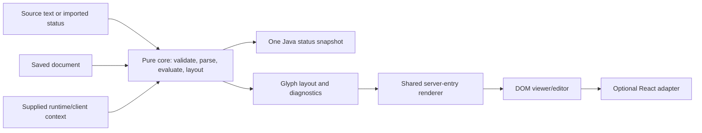

Keep persistent server intent separate from the data needed to display one
client's view. The same document can produce several client previews or status
responses without saving their temporary values.

## State ownership

| State                                   | Owner                                | Persist it?                                                                           |
| --------------------------------------- | ------------------------------------ | ------------------------------------------------------------------------------------- |
| `ServerListDocument`                    | Your application                     | Yes, through `writeDocument` and `readDocument`.                                      |
| `RuntimeContext`                        | Your authorized status/data provider | No; it supplies the base response, protocol decision, and literal placeholder values. |
| `PreviewContext`                        | Your application's viewer settings   | Store separately if useful; it is not server configuration.                           |
| Selection, caret, drafts, and undo      | The mounted editor                   | No; retain the handle and acknowledge document changes.                               |
| Textures, fonts, and panorama resources | Your asset provider                  | Separate from the server document and status payload.                                 |

The saved schema-1 document contains MOTD text/alignment, version rules, an
optional icon, player-count rules, hover rules, and JSON-only application
extensions. A server name or example ping value belongs to the client context,
not the server-supplied Java status description.

## Core and adapters

The Node-safe core does not import React, access a DOM, ping a server, or depend
on the Portal. The editor and viewer share layout and server-entry rendering;
editor tools surround that entry rather than changing native row geometry.

## Text and source fidelity

Text nodes have stable IDs. Styled groups retain formatting boundaries; explicit
`false` decorations override inherited styles. Glyph layout tracks source
positions independently from visual wrapping and resolved placeholder text.

Unchanged same-format serialization can return original source bytes. After an
edit, serialization produces equivalent structured content while retaining
protected raw subtrees. Unsupported conversions require explicit reduction and
diagnostics; they must not silently flatten unknown data.

### Protected components

Unknown MiniMessage constructs and JSON component metadata remain protected
atoms. A bounded, inert display projection can show known literal descendants,
colors, and decorations. It does not execute click/hover actions, HTML, commands,
or context-dependent translation/selector/NBT semantics.

If a JSON component array begins with a protected component, later entries can
inherit unknown metadata from it. Keep that complete dependency boundary as one
atom and use source editing for its dependent entries. Surrounding components
remain inline editable. Older saved trees that already lost this boundary need
the original JSON reimported; the missing source structure cannot be inferred.

<Note>
  Protected-first array preservation from library PRs #101 and #103 is available
  in `@groundsgg/motd` 0.4.0 and newer. Check the package changelog and your installed
  version. Source preservation does not certify arbitrary native component
  rendering.
</Note>

## Derived status values

Resolve displayed count rules before player placeholders. A hidden player field
does not make its underlying count rules meaningless: use `evaluatePlayerCounts`
when you need the values independently of native field visibility.

Use authoritative network-wide input for global counts. Do not substitute the
current proxy's local count. Your host owns environment selection, permissions,
freshness, failure handling, and explicitly labeled example values.

## Transactions and context updates

Document edits, source Apply, and image Apply are history transactions. Source,
import, and image dialogs stage drafts until Apply; cancellation does not save
them. External document replacement invalidates stale drafts. Context changes,
toolbar placement, and labels do not become MOTD edits.

`mapChange` lets an application add JSON-only intent to `extensions` inside the
same validation/history transaction. Undo and redo restore that intent together
with text; application-specific envelope fields stay outside the universal core.

The inline MOTD surface limits new input to two measured visual lines. Source
imports retain overlong content with diagnostics. Explicit layout export can
materialize wrapping and alignment, but refuses to split a protected component
or an unresolved token.

## Native fidelity and resources

Select the client profile independently of the advertised server version.
Profiles define geometry, font metrics, protocol metadata, and native behavior.
Their evidence remains scoped to the captures and cases actually measured.

MOTD and icon data are status snapshots. Static gradient/rainbow colors do not
advance on a timeline. Native obfuscation and menu panorama motion are separate
client-owned effects. See [Vanilla behavior](/reference/development/motd/vanilla-behavior).

Host resources are optional. Bundled artwork is independent of Minecraft game
assets; supplying a URL or hosting a texture does not establish redistribution
rights. Custom fonts and original assets need their own applicable permissions
and matching profile metrics.
