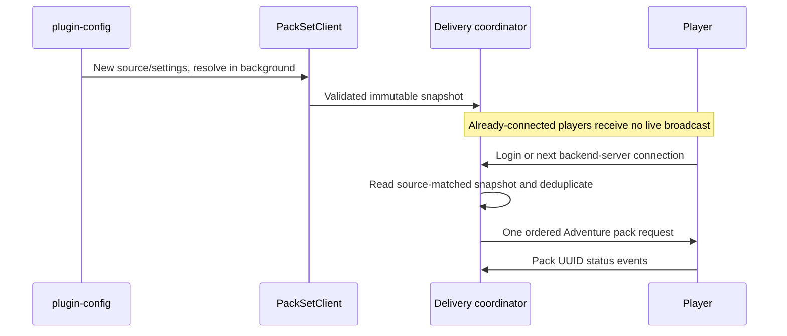

Install `plugin-resourcepacks` alongside `plugin-config` in Velocity. The configuration plugin owns authenticated snapshots, reconciliation, and change notifications. `plugin-resourcepacks` owns the background PackSet client and ordered Adventure delivery.

## Configuration scope

Set `GROUNDS_ENVIRONMENT` to the deployment environment, such as `stage`. It is required, nonblank, and cannot contain whitespace, `/`, or backslash. It selects:

```text
network/<environment>/resourcepacks/global
```

The seeded default document is:

```json
{
  "schemaVersion": 1,
  "enabled": true,
  "source": {
    "baseUrl": "https://cdn.grounds.gg",
    "packSet": "grounds-global",
    "channel": "stable",
    "pin": null
  },
  "required": true,
  "prompt": "Grounds benötigt seine Resourcepacks."
}
```

| Field | Behavior |
| --- | --- |
| `schemaVersion` | Config schema `1` |
| `enabled` | Enable/disable this delivery configuration |
| `source.baseUrl` | Distribution HTTPS origin |
| `source.packSet` | Product identifier |
| `source.channel` | `stable` or `edge`; environment does not infer the channel |
| `source.pin` | Optional/null to follow channel, or `{type: "release", id: "v1.1.0"}` |
| `required` | Required flag on the Adventure request |
| `prompt` | Player-facing resource-pack prompt |

Defaults seed an absent operator document. A genuinely `NOT_READY` manager snapshot is not an absent document: the plugin must not invent defaults, start a CDN client, or send packs until configuration is ready.

## Player transitions



Login/connection delivery reads memory only; it performs no synchronous Config Service or CDN request. One `Player.sendResourcePacks` request preserves UUID, URI, SHA-1, pack order, prompt, and required flag.

A new snapshot or delivery setting is adopted at the next safe backend connection. An unchanged fingerprint/settings target is suppressed per player. Disconnect clears that player's delivery record. Updating Config does not broadcast to players, disconnect them, or restart game/proxy processes.

## Fallback and cache

Deliver only a source-matched `READY` snapshot or a source-matched `DEGRADED` fallback. Source changes reconfigure the same client and must not offer old-source retained state. Without usable state, no guessed stack is sent.

Validated metadata is cached under `packset-cache` in the plugin data directory, normally `plugins/plugin-resourcepacks/packset-cache`. Persist and make that directory writable according to the deployment's storage ownership. A cached release pin can survive temporary CDN unavailability; changing selection still requires resolution of the selected source.

## Diagnostics and acceptance

Runtime status exposes client state, current/fallback fingerprints, and requested/accepted/downloaded/failed/declined counters. Status attribution uses pack UUIDs; Velocity does not identify the originating request. If overlapping requests reuse the same UUID, attribution is `unknown` rather than assuming the event belongs to the latest publication. That ambiguity can persist until disconnect/state clear.

Logs use bounded allowlisted reason codes for untrusted diagnostic text. Do not paste credentials, arbitrary upstream errors, or full private configuration into operator messages.

A successful selection write proves Config acceptance. Verify each proxy's source/target convergence and then test actual player transitions and acceptance. See the [operator checklist](/deploy/resourcepacks/operations).

## Security and scope

Keep Config reads authenticated and writes authorized for the exact environment/document. An arbitrary distribution origin is administrative input. The Forge selector is intentionally narrower: it fixes origin, PackSet, and Stage document, and can only change channel/pin.

There is no Minestom pack-delivery adapter or gamemode/per-server overlay in this plugin. Minestom hosts render scenes; Velocity supplies the global client PackSet.

## Implementation sources

Verified against the main-branch source on October 14, 2026.

- [Plugin configuration and semantics](https://github.com/groundsgg/plugin-resourcepacks/blob/e34725c57730cc9821cd652ddc5121f1f7045c88/README.md)
- [Delivery coordinator](https://github.com/groundsgg/plugin-resourcepacks/blob/e34725c57730cc9821cd652ddc5121f1f7045c88/velocity/src/main/kotlin/gg/grounds/resourcepacks/velocity/ResourcePackCoordinator.kt)
- [Status handling](https://github.com/groundsgg/plugin-resourcepacks/blob/e34725c57730cc9821cd652ddc5121f1f7045c88/velocity/src/main/kotlin/gg/grounds/resourcepacks/velocity/ResourcePackStatusListener.kt)
